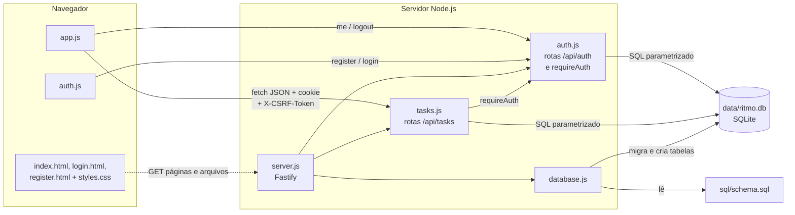
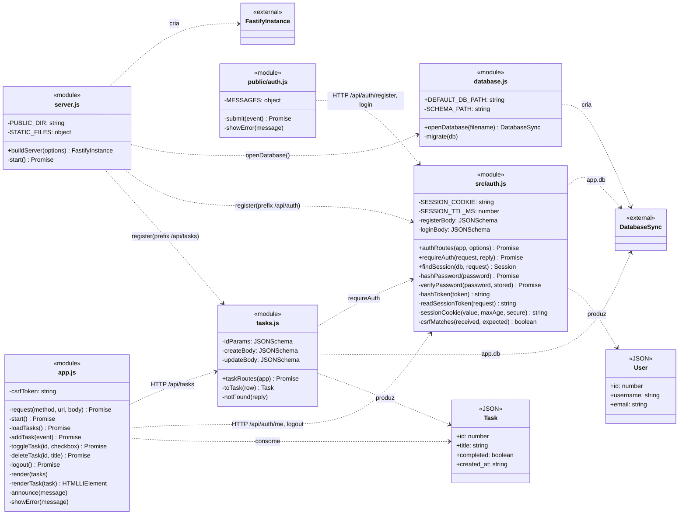
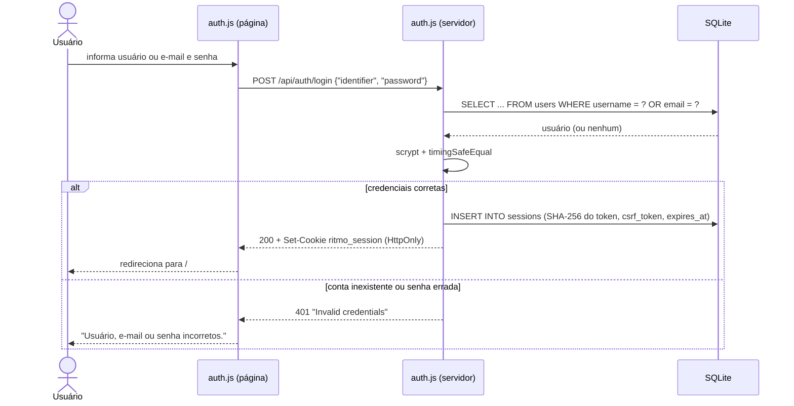
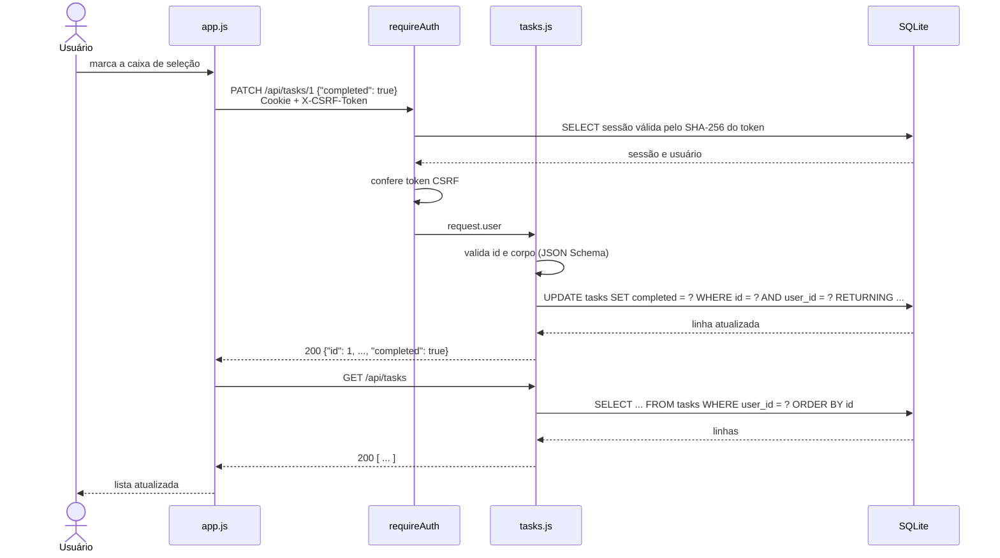

# Arquitetura

O Ritmo é uma aplicação monolítica em três camadas executada em um único processo Node.js. O mesmo servidor Fastify entrega as páginas web e expõe a API REST, que acessa o banco SQLite local. O acesso às tarefas exige autenticação por sessão com cookie.

## Responsabilidades

### Front-end (`public/`)

- `index.html`: página de tarefas, com cabeçalho (nome do usuário e botão **Sair**), formulário, área de erro, região de status para leitores de tela, mensagem de lista vazia e lista de tarefas.
- `login.html` e `register.html`: formulários de login (usuário ou e-mail e senha) e de cadastro (usuário, e-mail e senha), com rótulos visíveis e validação nativa do navegador.
- `styles.css`: layout responsivo (largura máxima de 640 px) e tema claro/escuro por `prefers-color-scheme`, compartilhado pelas três páginas.
- `app.js` (página de tarefas):
  - ao abrir, consulta `GET /api/auth/me` para obter o nome do usuário e o token CSRF;
  - consome a API `/api/tasks` com `fetch`, enviando `X-CSRF-Token` nas requisições que alteram dados;
  - redireciona para `/login` quando qualquer resposta é 401 (sessão expirada ou encerrada);
  - recarrega a lista (`GET`) após cada operação, mantendo a tela igual ao banco;
  - pede confirmação antes de excluir, valida o título vazio antes de enviar e exibe mensagens em português;
  - **Sair** chama `POST /api/auth/logout` e volta para `/login`.
- `auth.js` (páginas de login e cadastro): envia o formulário como JSON para o endpoint indicado em `data-endpoint`, redireciona para `/` em caso de sucesso e traduz os erros da API (credenciais inválidas, usuário ou e-mail já cadastrado).

### Back-end (`src/`)

- `server.js`:
  - `buildServer()` cria a instância do Fastify, abre o banco e o disponibiliza como `app.db`;
  - fecha a conexão ao encerrar e registra as rotas de autenticação em `/api/auth` e as de tarefas em `/api/tasks`;
  - serve as páginas e arquivos de `public/` e a rota `/health`. A página `/` redireciona para `/login` sem sessão; `/login` e `/register` redirecionam para `/` com sessão;
  - ativa o atributo `Secure` do cookie quando `NODE_ENV=production` (ou pela opção `secureCookies`);
  - desativa a conversão automática de tipos na validação, para que, por exemplo, `"true"` não seja aceito como booleano;
  - `start()` lê `PORT` e `HOST` e inicia o servidor quando o arquivo é executado diretamente.
- `auth.js`:
  - plugin com `register`, `login`, `me` e `logout`;
  - gera e verifica hashes de senha com `crypto.scrypt` (salt aleatório de 16 bytes, comparação em tempo constante);
  - cria sessões com tokens aleatórios de 32 bytes, guardando no banco apenas o SHA-256 do token;
  - exporta `requireAuth`, hook que carrega a sessão a partir do cookie (401 se ausente ou expirada) e confere o token CSRF em `POST`/`PUT`/`PATCH`/`DELETE` (403 se incorreto). Preenche `request.user` e `request.session`;
  - exporta `findSession`, usada pelo servidor para decidir os redirecionamentos das páginas.
- `tasks.js`: plugin Fastify com os quatro endpoints de tarefas, protegidos por `requireAuth` (hook `onRequest`). Valida entradas com JSON Schema, executa consultas sempre filtradas por `user_id = request.user.id` e converte `completed` de 0/1 para booleano (`toTask`). O `user_id` não é exposto nas respostas.

### Persistência (`src/database.js` e `sql/schema.sql`)

- `openDatabase()` cria a pasta do banco se necessário, abre o arquivo com `DatabaseSync` (`node:sqlite`), ativa as chaves estrangeiras, executa a migração (`migrate()`) e aplica `schema.sql`.
- `migrate()` adiciona `tasks.user_id` em bancos criados antes da autenticação. Detalhes em [Modelo de dados](modelo-de-dados.md#migração-de-bancos-existentes).
- O schema usa `CREATE TABLE/INDEX IF NOT EXISTS`, então é aplicado a cada inicialização sem apagar dados.
- As regras de integridade (título obrigatório, `completed` em 0/1, username e e-mail únicos, chaves estrangeiras) também estão no banco, não apenas na API.

## Decisões de segurança

| Tema | Decisão |
|---|---|
| Senhas | `crypto.scrypt` nativo (N=16384, r=8, p=1, 64 bytes), salt aleatório por senha, parâmetros gravados junto ao hash e comparação com `timingSafeEqual`. |
| Sessões | Token de 32 bytes de `crypto.randomBytes`, guardado no banco apenas como SHA-256; validade de 7 dias, verificada no servidor; removido no logout; um novo login descarta a sessão anterior enviada na requisição. |
| Cookie | `HttpOnly`, `SameSite=Lax`, `Path=/`, `Max-Age` de 7 dias e `Secure` em produção. Lido e escrito sem bibliotecas adicionais. |
| CSRF | Token por sessão exigido no cabeçalho `X-CSRF-Token` nas requisições autenticadas que alteram dados, somado ao `SameSite=Lax`. Login e cadastro aceitam somente JSON, o que impede o envio por formulários de outros sites. |
| Enumeração de usuários | O login devolve o mesmo 401 para conta inexistente e senha errada, e calcula o scrypt nos dois casos. O cadastro informa e-mail ou username duplicado (409), pois o usuário precisa saber o que corrigir. |
| Isolamento | Todas as consultas de tarefas incluem `user_id = ?`; tarefa de outra conta retorna 404. |
| SQL | Somente consultas parametrizadas (`prepare(...).get/run/all` com `?`). |
| Dependências | Nenhuma nova: `node:crypto` cobre scrypt, tokens e hashes. |

## Diagrama de classes

O código não define classes JavaScript. Os módulos são representados como classes com o estereótipo `<<module>>`, e os formatos trocados com a API, como `<<JSON>>`. Os membros `+` são exportados pelo módulo e os `-` são internos. `FastifyInstance` e `DatabaseSync` vêm de bibliotecas externas.

## Fluxo de login

## Fluxo de uma operação

Exemplo de conclusão de tarefa (UC03). Os demais fluxos seguem o mesmo padrão: requisição de alteração seguida de recarga da lista.

Em caso de erro (400, 404, 500 ou falha de rede), `app.js` exibe a mensagem correspondente, desfaz a marcação e recarrega a lista. Em caso de 401, redireciona para `/login`.
