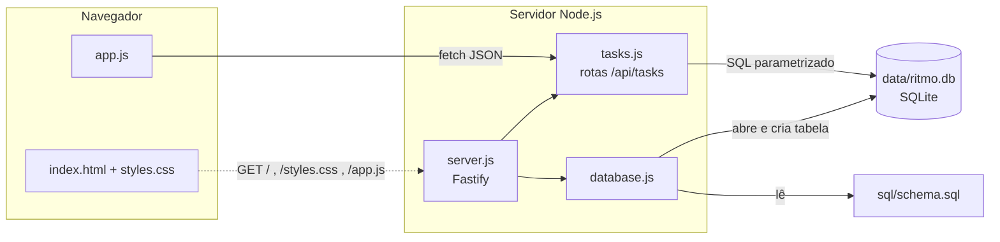
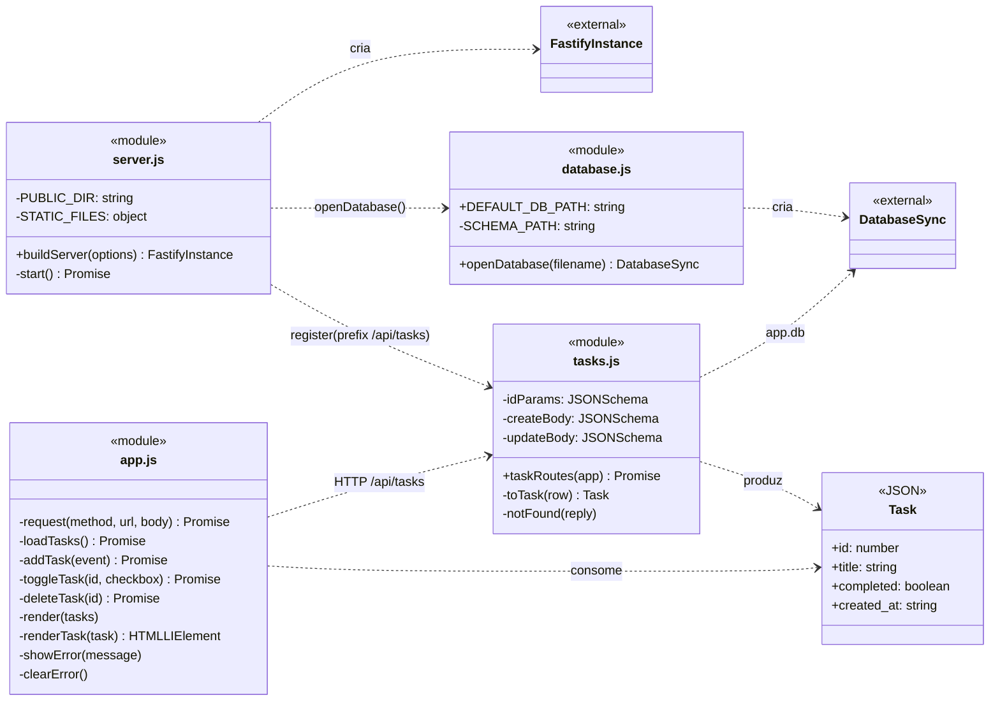
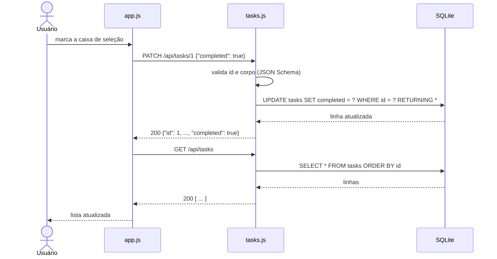

# Arquitetura

O Ritmo é uma aplicação monolítica em três camadas executada em um único processo Node.js. O mesmo servidor Fastify entrega a página web e expõe a API REST, que acessa o banco SQLite local.

## Responsabilidades

### Front-end (`public/`)

- `index.html`: estrutura da página, com título, formulário, área de erro, mensagem de lista vazia e lista de tarefas.
- `styles.css`: layout responsivo (largura máxima de 640 px) e tema claro/escuro por `prefers-color-scheme`.
- `app.js`:
  - consome exclusivamente a API `/api/tasks` com `fetch`;
  - recarrega a lista (`GET`) após cada operação, mantendo a tela igual ao banco;
  - valida o título vazio antes de enviar;
  - exibe mensagens de erro em português.

### Back-end (`src/`)

- `server.js`:
  - `buildServer()` cria a instância do Fastify, abre o banco e o disponibiliza como `app.db`;
  - fecha a conexão ao encerrar e registra as rotas de tarefas em `/api/tasks`;
  - serve os três arquivos de `public/` e a rota `/health`;
  - desativa a conversão automática de tipos na validação, para que, por exemplo, `"true"` não seja aceito como booleano;
  - `start()` lê `PORT` e `HOST` e inicia o servidor quando o arquivo é executado diretamente.
- `tasks.js`: plugin Fastify com os quatro endpoints. Valida entradas com JSON Schema, executa as consultas e converte `completed` de 0/1 para booleano (`toTask`).

### Persistência (`src/database.js` e `sql/schema.sql`)

- `openDatabase()` cria a pasta do banco se necessário, abre o arquivo com `DatabaseSync` (`node:sqlite`) e executa `schema.sql`.
- O schema usa `CREATE TABLE IF NOT EXISTS`, então é aplicado a cada inicialização sem apagar dados.
- As regras de integridade (título obrigatório, `completed` em 0/1) também estão no banco, não apenas na API.

## Diagrama de classes

O código não define classes JavaScript. Os módulos são representados como classes com o estereótipo `<<module>>`, e a forma de uma tarefa na API, como `<<JSON>>`. Os membros `+` são exportados pelo módulo e os `-` são internos. `FastifyInstance` e `DatabaseSync` vêm de bibliotecas externas.

## Fluxo de uma operação

Exemplo de conclusão de tarefa (UC03). Os demais fluxos seguem o mesmo padrão: requisição de alteração seguida de recarga da lista.

Em caso de erro (400, 404, 500 ou falha de rede), `app.js` exibe a mensagem correspondente, desfaz a marcação e recarrega a lista.
