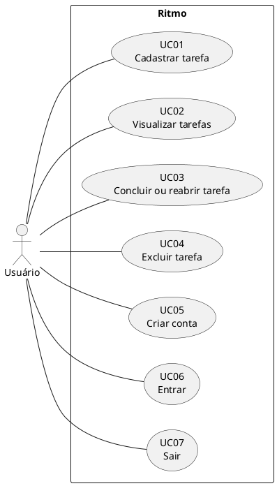

# Casos de uso

## Diagrama

Versão em PNG para documentos: [`diagramas/casos-de-uso.png`](diagramas/casos-de-uso.png).

Fonte equivalente em PlantUML:

O sistema tem um único ator, o **Usuário**. Cada usuário tem sua própria conta, e os casos UC01 a UC04 e UC07 exigem que ele esteja autenticado (UC06). Um usuário só vê e altera as próprias tarefas.

## Descrições

**Pré-condição de UC01 a UC04 e UC07:** usuário autenticado. Sem sessão válida, a página de tarefas redireciona para o login, e uma sessão que expira durante o uso também leva ao login na próxima operação.

### UC01 — Cadastrar tarefa

**Requisitos:** RF01 a RF05, RF16.

1. O usuário digita o título no campo "O que você precisa fazer?" e aciona **Adicionar** ou a tecla Enter.
2. O sistema remove os espaços das pontas do título, salva a tarefa como não concluída e registra a data de criação.
3. O sistema limpa o campo e atualiza a lista.

**Fluxos alternativos**

- Título vazio ou só com espaços: a interface exibe "Digite um título para a tarefa." e nada é enviado à API.
- Falha na requisição: a interface exibe "Não foi possível adicionar a tarefa." e devolve o título ao campo.

### UC02 — Visualizar tarefas

**Requisitos:** RF06, RF09, RF11, RF16.

1. O usuário abre a página.
2. O sistema exibe o nome do usuário e carrega as tarefas dele em ordem de criação, exibindo as concluídas com o título riscado.

**Fluxos alternativos**

- Nenhuma tarefa cadastrada: a interface exibe "Nenhuma tarefa cadastrada.".
- Falha na requisição: a interface exibe "Não foi possível carregar as tarefas.".

### UC03 — Concluir ou reabrir tarefa

**Requisito:** RF07.

1. O usuário marca ou desmarca a caixa de seleção da tarefa.
2. O sistema atualiza o estado da tarefa e recarrega a lista.

**Fluxo alternativo**

- Falha na requisição (inclusive tarefa já excluída): a interface exibe "Não foi possível atualizar a tarefa.", desfaz a marcação e recarrega a lista.

### UC04 — Excluir tarefa

**Requisitos:** RF08, RF19.

1. O usuário aciona **Excluir** na tarefa.
2. O sistema pede confirmação ("Excluir a tarefa "título"?").
3. O usuário confirma.
4. O sistema remove a tarefa, anuncia a exclusão aos leitores de tela e recarrega a lista.

**Fluxos alternativos**

- O usuário cancela a confirmação: nada é enviado e a tarefa permanece.
- Falha na requisição (inclusive tarefa já excluída): a interface exibe "Não foi possível excluir a tarefa." e recarrega a lista.

### UC05 — Criar conta

**Requisitos:** RF12, RF13, RF17.

1. Na página **Criar conta** (`/register`), o usuário informa nome de usuário, e-mail e senha e aciona **Criar conta**.
2. O sistema valida os dados, grava a conta com a senha protegida por hash e inicia a sessão.
3. O sistema abre a página de tarefas, inicialmente vazia.

**Fluxos alternativos**

- Nome de usuário já usado (sem diferenciar maiúsculas): a interface exibe "Este nome de usuário já está em uso.".
- E-mail já cadastrado (sem diferenciar maiúsculas): a interface exibe "Este e-mail já está cadastrado.".
- Dados fora das regras (username com `@`, e-mail inválido, senha com menos de 8 caracteres etc.): o navegador indica o campo; se a API rejeitar, a interface exibe "Verifique os dados informados.".

### UC06 — Entrar

**Requisitos:** RF14, RF15, RF17.

1. Na página **Entrar** (`/login`), o usuário informa o nome de usuário **ou** o e-mail e a senha e aciona **Entrar**.
2. O sistema identifica a conta, confere a senha e inicia uma sessão de 7 dias.
3. O sistema abre a página de tarefas. Ao atualizar a página ou reabrir o navegador dentro da validade, o usuário continua autenticado.

**Fluxo alternativo**

- Conta inexistente ou senha incorreta: a interface exibe "Usuário, e-mail ou senha incorretos.", sem indicar qual dado está errado.

### UC07 — Sair

**Requisito:** RF18.

1. Na página de tarefas, o usuário aciona **Sair**.
2. O sistema encerra a sessão no servidor, apaga o cookie e abre a página de login.

**Fluxo alternativo**

- Falha na requisição: a interface exibe "Não foi possível sair." e o usuário continua na página.
