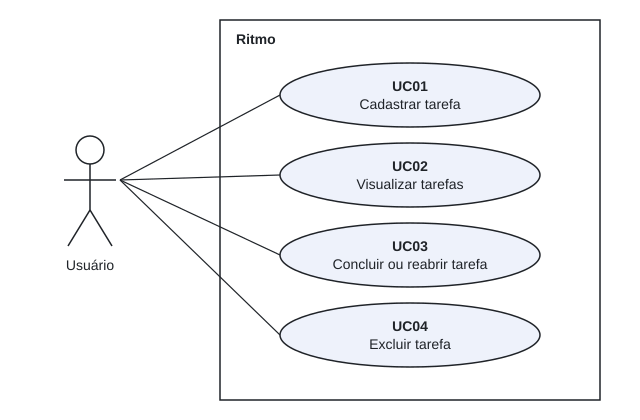
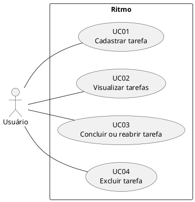

# Casos de uso

## Diagrama

Versão em PNG para documentos: [`diagramas/casos-de-uso.png`](diagramas/casos-de-uso.png).

Fonte equivalente em PlantUML:

O sistema tem um único ator, o **Usuário**, pois o Ritmo é de uso pessoal e não possui autenticação.

## Descrições

### UC01 — Cadastrar tarefa

**Requisitos:** RF01 a RF05.

1. O usuário digita o título no campo "O que você precisa fazer?" e aciona **Adicionar** ou a tecla Enter.
2. O sistema remove os espaços das pontas do título, salva a tarefa como não concluída e registra a data de criação.
3. O sistema limpa o campo e atualiza a lista.

**Fluxos alternativos**

- Título vazio ou só com espaços: a interface exibe "Digite um título para a tarefa." e nada é enviado à API.
- Falha na requisição: a interface exibe "Não foi possível adicionar a tarefa." e devolve o título ao campo.

### UC02 — Visualizar tarefas

**Requisitos:** RF06, RF09, RF11.

1. O usuário abre a página.
2. O sistema carrega as tarefas em ordem de criação, exibindo as concluídas com o título riscado.

**Fluxos alternativos**

- Nenhuma tarefa cadastrada: a interface exibe "Nenhuma tarefa cadastrada.".
- Falha na requisição: a interface exibe "Não foi possível carregar as tarefas.".

### UC03 — Concluir ou reabrir tarefa

**Requisito:** RF07.

1. O usuário marca ou desmarca a caixa de seleção da tarefa.
2. O sistema atualiza o estado da tarefa e recarrega a lista.

**Fluxo alternativo**

- Falha na requisição (inclusive tarefa já excluída): a interface exibe "Não foi possível atualizar a tarefa.", desfaz a marcação e recarrega a lista.

### UC04 — Excluir tarefa

**Requisitos:** RF08, RF19.

1. O usuário aciona **Excluir** na tarefa.
2. O sistema pede confirmação ("Excluir a tarefa "título"?").
3. O usuário confirma.
4. O sistema remove a tarefa, anuncia a exclusão aos leitores de tela e recarrega a lista.

**Fluxos alternativos**

- O usuário cancela a confirmação: nada é enviado e a tarefa permanece.
- Falha na requisição (inclusive tarefa já excluída): a interface exibe "Não foi possível excluir a tarefa." e recarrega a lista.
