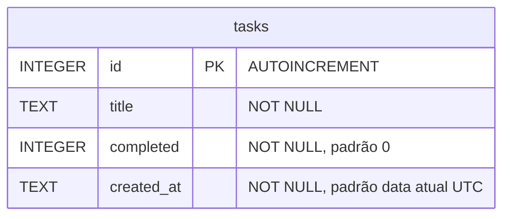

# Modelo de dados

O banco possui uma única tabela, `tasks`, definida em [`sql/schema.sql`](../sql/schema.sql). Não há relacionamentos.

## Dicionário de dados — `tasks`

| Coluna | Tipo SQLite | Nulo | Padrão | Restrições | Descrição |
|---|---|---|---|---|---|
| `id` | `INTEGER` | Não | Gerado | `PRIMARY KEY AUTOINCREMENT` | Identificador único da tarefa. Valores de tarefas excluídas não são reutilizados. |
| `title` | `TEXT` | Não | — | `NOT NULL`, `CHECK (length(trim(title)) > 0)` | Título da tarefa. A API grava o texto sem os espaços das pontas. Não há limite de tamanho. |
| `completed` | `INTEGER` | Não | `0` | `CHECK (completed IN (0, 1))` | Situação da tarefa: `0` = pendente, `1` = concluída. |
| `created_at` | `TEXT` | Não | `strftime('%Y-%m-%dT%H:%M:%fZ', 'now')` | `NOT NULL` | Data e hora de criação em UTC, no formato ISO 8601 com milissegundos (ex.: `2026-11-03T21:59:39.856Z`). Preenchida pelo banco. |

## Observações

- **Booleano:** o SQLite não tem tipo booleano, por isso `completed` é armazenado como 0/1. A API converte para `true`/`false` nas respostas e converte de volta ao gravar.
- **Tabela interna:** por causa do `AUTOINCREMENT`, o SQLite mantém automaticamente a tabela interna `sqlite_sequence` com o último `id` gerado.
- **Índices:** não há índices além da chave primária.
- **Criação do schema:** o schema é aplicado a cada inicialização com `CREATE TABLE IF NOT EXISTS`. Alterações futuras em uma tabela já existente exigirão um script de migração, que o projeto ainda não possui.
- **Localização:** o banco fica em `data/ritmo.db` por padrão (configurável por `DB_PATH`), e esse arquivo é ignorado pelo Git.
