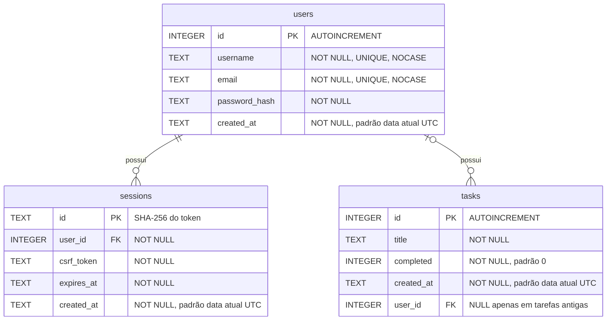

# Modelo de dados

O banco possui três tabelas, definidas em [`sql/schema.sql`](../sql/schema.sql): `users`, `sessions` e `tasks`. Cada sessão e cada tarefa pertencem a um usuário.



## Dicionário de dados — `users`

| Coluna | Tipo SQLite | Nulo | Padrão | Restrições | Descrição |
|---|---|---|---|---|---|
| `id` | `INTEGER` | Não | Gerado | `PRIMARY KEY AUTOINCREMENT` | Identificador do usuário. |
| `username` | `TEXT` | Não | — | `UNIQUE`, `COLLATE NOCASE`, `CHECK` de 3 a 30 caracteres e sem `@` | Nome de usuário, com a grafia informada no cadastro. A API também restringe os caracteres a letras sem acento, números, `.`, `_` e `-`. |
| `email` | `TEXT` | Não | — | `UNIQUE`, `COLLATE NOCASE`, `CHECK` contendo `@` após o primeiro caractere | E-mail, gravado em minúsculas pela API. |
| `password_hash` | `TEXT` | Não | — | `NOT NULL` | Hash scrypt da senha no formato `scrypt$N$r$p$salt$hash` (salt e hash em base64). A senha em texto puro nunca é gravada. |
| `created_at` | `TEXT` | Não | `strftime('%Y-%m-%dT%H:%M:%fZ', 'now')` | `NOT NULL` | Data e hora do cadastro em UTC. |

## Dicionário de dados — `sessions`

| Coluna | Tipo SQLite | Nulo | Padrão | Restrições | Descrição |
|---|---|---|---|---|---|
| `id` | `TEXT` | Não | — | `PRIMARY KEY` | SHA-256 (hexadecimal) do token enviado no cookie. Quem lê o banco não obtém um token utilizável. |
| `user_id` | `INTEGER` | Não | — | `REFERENCES users (id)`, índice `sessions_user_id` | Dono da sessão. |
| `csrf_token` | `TEXT` | Não | — | `NOT NULL` | Token que o cliente deve enviar no cabeçalho `X-CSRF-Token`. |
| `expires_at` | `TEXT` | Não | — | `NOT NULL` | Fim da validade (7 dias após o login), em UTC no formato ISO 8601. |
| `created_at` | `TEXT` | Não | `strftime('%Y-%m-%dT%H:%M:%fZ', 'now')` | `NOT NULL` | Início da sessão. |

A sessão é apagada no logout. Sessões expiradas deixam de ser aceitas imediatamente e são removidas a cada novo login ou cadastro.

## Dicionário de dados — `tasks`

| Coluna | Tipo SQLite | Nulo | Padrão | Restrições | Descrição |
|---|---|---|---|---|---|
| `id` | `INTEGER` | Não | Gerado | `PRIMARY KEY AUTOINCREMENT` | Identificador único da tarefa. Valores de tarefas excluídas não são reutilizados. |
| `title` | `TEXT` | Não | — | `NOT NULL`, `CHECK (length(trim(title)) > 0)` | Título da tarefa. A API grava o texto sem os espaços das pontas. Não há limite de tamanho. |
| `completed` | `INTEGER` | Não | `0` | `CHECK (completed IN (0, 1))` | Situação da tarefa: `0` = pendente, `1` = concluída. |
| `created_at` | `TEXT` | Não | `strftime('%Y-%m-%dT%H:%M:%fZ', 'now')` | `NOT NULL` | Data e hora de criação em UTC, no formato ISO 8601 com milissegundos (ex.: `2026-11-03T21:59:39.856Z`). Preenchida pelo banco. |
| `user_id` | `INTEGER` | Sim | `NULL` | `REFERENCES users (id)`, índice `tasks_user_id` | Dono da tarefa. A API sempre preenche ao criar e filtra por ele em todas as consultas. Fica `NULL` apenas em tarefas criadas antes da autenticação. |

## Migração de bancos existentes

Bancos criados antes da autenticação têm a tabela `tasks` sem a coluna `user_id`. Ao abrir o banco, `openDatabase()` (`src/database.js`):

1. ativa `PRAGMA foreign_keys = ON`;
2. se `tasks` existir sem `user_id`, executa `ALTER TABLE tasks ADD COLUMN user_id INTEGER REFERENCES users (id)`;
3. aplica `schema.sql`, que cria `users`, `sessions` e os índices quando ainda não existem.

A migração é idempotente e não apaga nem altera tarefas. As tarefas antigas ficam com `user_id = NULL`: continuam no banco, mas **não aparecem para nenhuma conta**, porque toda consulta da API usa `WHERE user_id = ?`. Elas não são atribuídas automaticamente a ninguém. Para entregá-las a uma conta, o responsável pelo banco pode executar manualmente, por exemplo:

```sql
UPDATE tasks SET user_id = (SELECT id FROM users WHERE username = 'ana') WHERE user_id IS NULL;
```

A coluna `user_id` aceita `NULL` porque o SQLite só permite adicionar uma coluna `NOT NULL` com um valor padrão, e não há dono padrão aceitável. Para manter o mesmo schema em bancos novos e migrados, a definição em `schema.sql` também aceita `NULL`.

## Observações

- **Booleano:** o SQLite não tem tipo booleano, por isso `completed` é armazenado como 0/1. A API converte para `true`/`false` nas respostas e converte de volta ao gravar.
- **Maiúsculas e minúsculas:** `COLLATE NOCASE` faz `username` e `email` serem únicos e comparados sem diferenciar maiúsculas (letras ASCII). Por isso o username é limitado a ASCII, e o e-mail é gravado em minúsculas.
- **Chaves estrangeiras:** ativadas em cada conexão (`PRAGMA foreign_keys = ON`); o banco rejeita tarefa ou sessão de usuário inexistente.
- **Tabela interna:** por causa do `AUTOINCREMENT`, o SQLite mantém automaticamente a tabela interna `sqlite_sequence` com o último `id` gerado.
- **Índices:** além das chaves primárias e dos índices automáticos de `UNIQUE`, há `tasks_user_id` e `sessions_user_id`.
- **Localização:** o banco fica em `data/ritmo.db` por padrão (configurável por `DB_PATH`), e esse arquivo é ignorado pelo Git.
